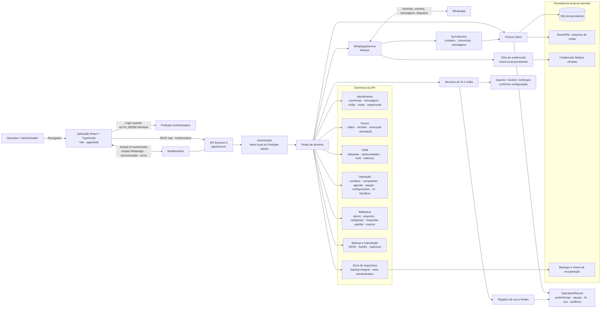
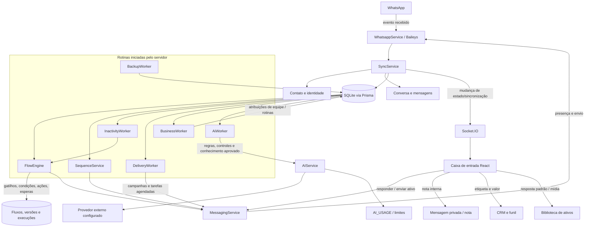
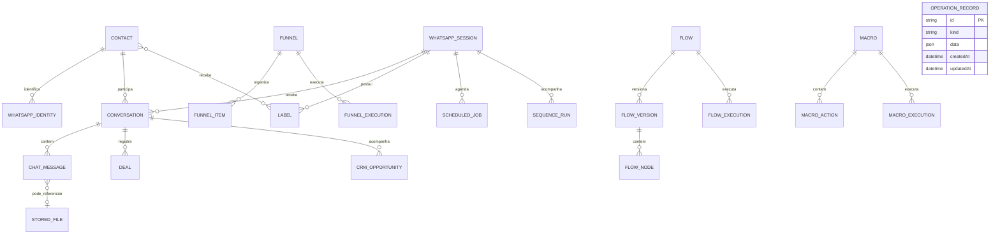
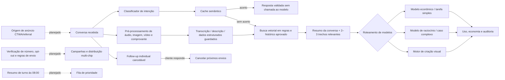

# Arquitetura completa — Noctua CRM

Este documento descreve a arquitetura que encontrei no código atual e separa os recursos existentes daqueles ainda planejados. Os diagramas estão em Mermaid: o VS Code pode exibi-los com uma extensão Mermaid, e o conteúdo também pode ser copiado para ferramentas compatíveis.

## 1. Visão geral do sistema atual



## 2. Fluxo de atendimento e automações



## 3. Dados e relações principais



**Principais grupos persistidos no SQLite:** sessões WhatsApp e autenticação; configurações por sessão; contatos e identidades; conversas, mensagens e arquivos; etiquetas e relações de contato; negócios/oportunidades; biblioteca de ativos; macros e ações; funis; fluxos e versões; execuções e eventos; tarefas agendadas e sequências; PIX; importações; e registros operacionais usados para preferências, equipe, IA, uso e auditoria.

## 4. Desenvolvimento local e publicação

```mermaid
flowchart LR
    subgraph Computador do usuário / desenvolvimento
      VITE[Vite dev server<br/>127.0.0.1:5173]
      SERVER[API Node / Express<br/>127.0.0.1:3333]
      SQLITE[(SQLite em disco)]
      KEY[Arquivo de chave WhatsApp<br/>persistente e fora do Git]
      VITE -->|VITE_API_URL ou proxy| SERVER
      SERVER --> SQLITE
      SERVER --> KEY
    end

    subgraph Publicação online — componentes separados
      VERCEL[Vercel<br/>constrói e serve apps/web/dist]
      PERSIST[Servidor persistente / container Docker<br/>API + Socket.IO + workers]
      DISK[(Volume persistente<br/>banco · chave · backups · arquivos)]
      VERCEL -->|HTTPS REST + Socket.IO<br/>VITE_API_URL| PERSIST
      PERSIST --> DISK
    end

    AUTH[Firebase Authentication opcional] --> VERCEL
    AUTH -->|token verificado pelo Firebase Admin| PERSIST
    PERSIST --> WAPP[WhatsApp via Baileys]
    PERSIST --> AI[Provedor de IA configurado]
```

### O que isso significa para manter o site online

- A configuração da Vercel neste repositório compila e publica o **front-end** (`apps/web/dist`).
- A API atual mantém conexões WhatsApp, Socket.IO e tarefas em segundo plano; por isso, precisa de um processo de servidor persistente e armazenamento persistente.
- O diagrama de publicação exige apontar `VITE_API_URL` para a API pública e configurar a origem permitida no servidor. Credenciais ficam em variáveis/arquivos seguros do ambiente, nunca no Git.
- Uma publicação só do front-end na Vercel não mantém o backend WhatsApp ligado. Se a API ou o volume persistente parar, login/conexões, dados locais e tarefas podem falhar.
- Em produção, o banco SQLite precisa de volume persistente e cópias de segurança. Não use armazenamento efêmero de função/serverless para guardar sessões WhatsApp ou o banco.

## 5. Recursos planejados das Partes 5 a 7

O diagrama abaixo representa **extensões pedidas, mas que não encontrei completas no código**. Ele não deve ser interpretado como sistema já disponível.



## 6. Onde localizar os componentes no projeto

| Área | Local principal |
|---|---|
| Interface e rotas | `apps/web/src/App.tsx`, `apps/web/src/pages/` e `apps/web/src/components/` |
| Estilos | `apps/web/src/styles.css`, `layout.css`, `attendance.css` e estilos por módulo |
| Autenticação do navegador | `apps/web/src/auth/` |
| Inicialização e rotas HTTP | `apps/server/src/app.ts`, `apps/server/src/server.ts` |
| Autorização | `apps/server/src/http/auth.ts` |
| Banco e tabelas | `apps/server/prisma/schema.prisma` |
| WhatsApp | `apps/server/src/modules/whatsapp/` |
| Atendimento e envio | `apps/server/src/modules/attendance/` |
| Fluxos | `apps/server/src/modules/flows/` |
| CRM | `apps/server/src/modules/crm/` |
| Campanhas, IA, equipe, agenda, biblioteca e backups | `apps/server/src/modules/operations/` e `modules/backups/` |
| Tempo real | `apps/server/src/realtime/socket.ts` |
| Publicação do site | `vercel.json` |
| Servidor em container | `Dockerfile` |

## 7. Recursos pedidos que ainda não aparecem como integração completa

- Sandbox acessível pelo menu, com dados fictícios isolados no armazenamento local do navegador; ainda requer validação manual.
- Motores separados Gemini Flash/Pro/Imagem, geração visual por cliente, marca d’água e compressão automática.
- Detector estruturado de comprovantes, player com corte de silêncios e avaliação automática pós-atendimento.
- Follow-up individual cancelável, origem CTWA/referral, resumo noturno, validação de conta WhatsApp, rotação de chips e opt-out automático por palavras.
- Menu de Economia de Tokens, cache semântico, RAG vetorial, resumo de contexto ajustável, otimizador de prompts e roteamento por intenção.
- A Parte 8 ainda precisa ser especificada para entrar nesta arquitetura.

**Base do diagrama:** estrutura e arquivos atuais do repositório. Os blocos planejados estão marcados explicitamente e não indicam implementação concluída.

## Atualização de 27/10/2026 — licenças e operações independentes

A API agora possui uma porta de entrada que valida a conta e seleciona o banco da operação. O registro privado de licenças é separado da operação original. Cada cliente recebe SQLite, cifra e backups próprios; o Socket.IO publica em salas por operação. O proprietário acessa /chaves; clientes ativam uma chave após autenticar. Nenhuma cobrança automática foi integrada. Consulte [Chaves de acesso](chaves-de-acesso.md) para caminhos, limites, testes e recuperação da plataforma.
